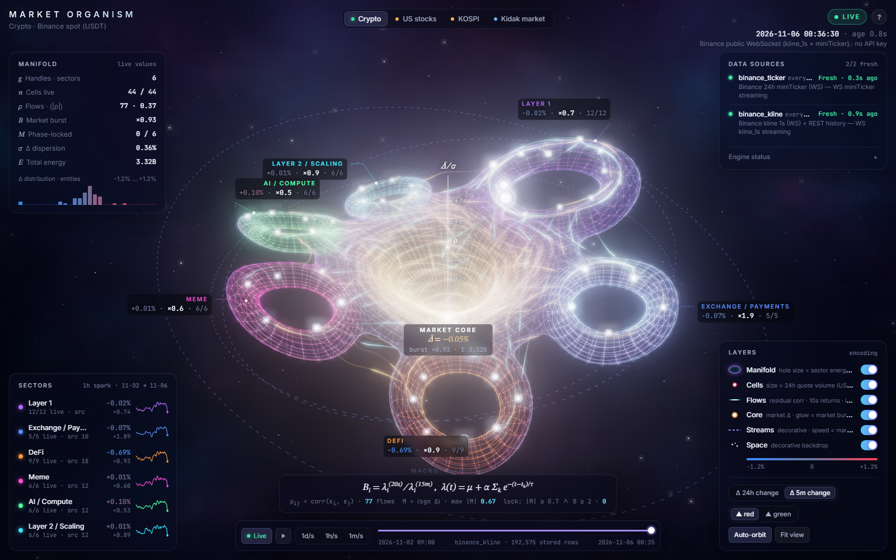
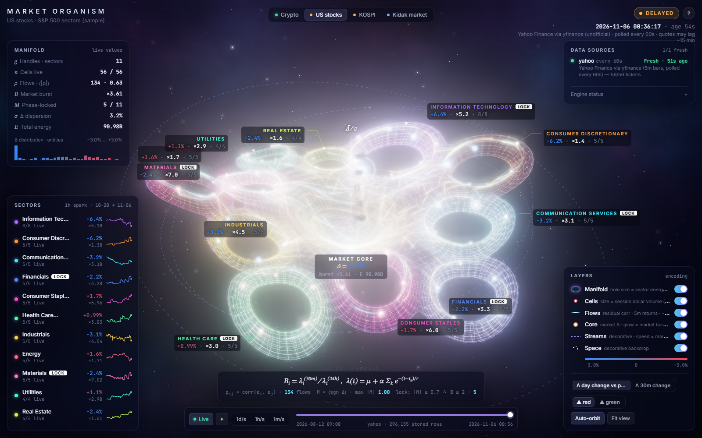
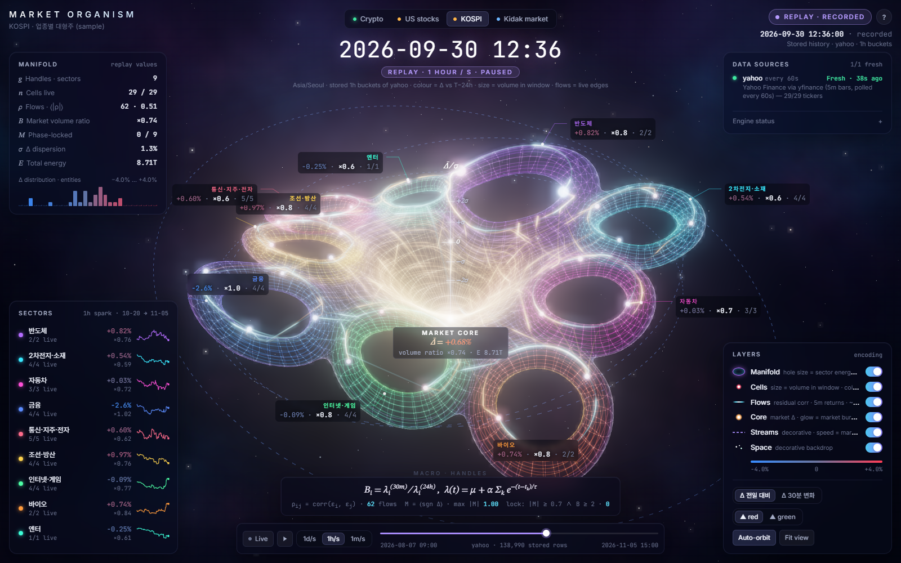
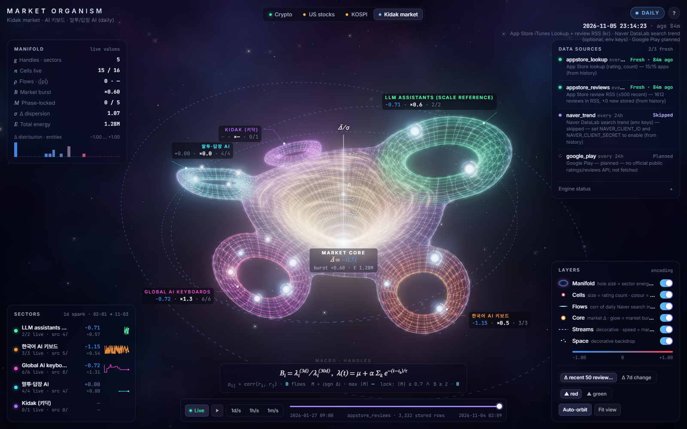
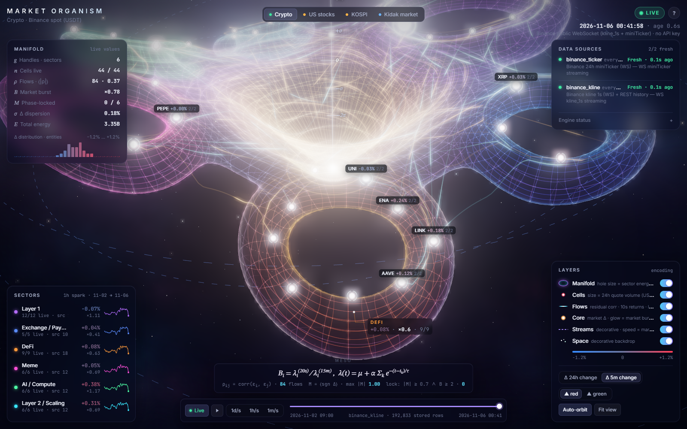
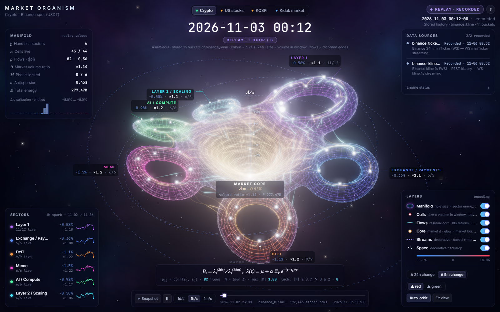
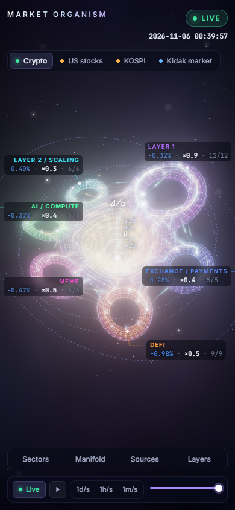
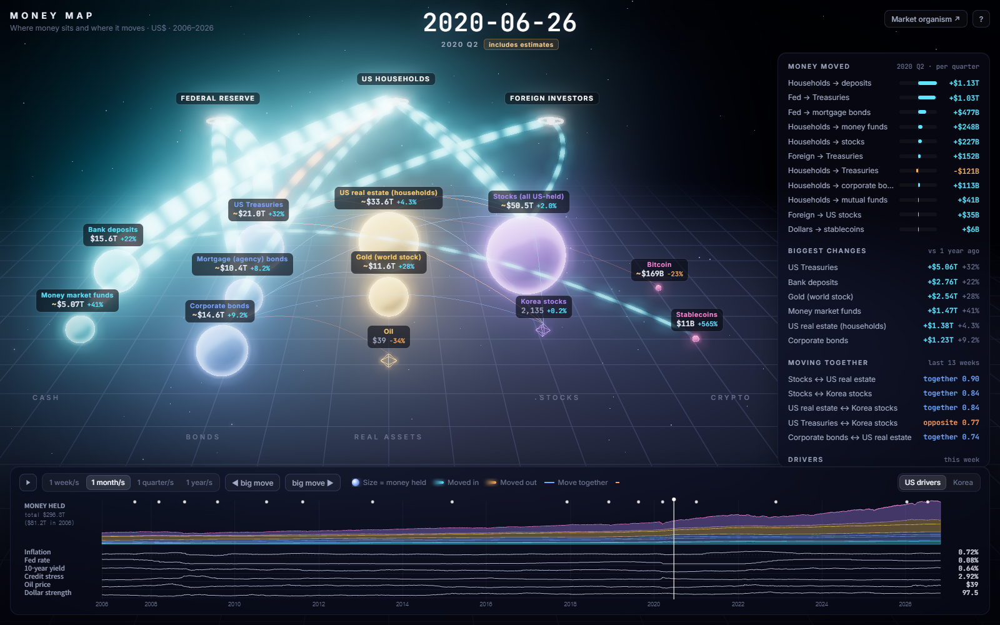

# Market Organism

**Live demo (recorded snapshot + replay):** https://lollloolloll.github.io/3d_test/

A generic visualization engine that draws a market as **one living 3D manifold**: a single smooth multi-handle
surface floating in space. Each sector is a handle (a hole through the surface), each entity is a glowing cell on it,
correlations are flowing ribbons across it, and the market aggregate is the bright throat at its centre. Live, delayed
and daily data share one render path, and stored history replays as a time-lapse.

| organism part | market meaning (data) |
|---|---|
| **handle** (a hole through the manifold) | sector / cluster. **Hole size** = the sector's energy share. **Lift** of the surface around it = sector Δ. **Rim glow** = sector Hawkes burst. **White rim** = phase-lock |
| handle **order** around the ring | greedy seriation of sector correlations: correlated sectors sit next to each other (set once from the first edges) |
| **cell** (glowing particle on the surface) | entity: coin, stock, app |
| cell **size** | energy: 24h quote volume, session dollar volume, App Store rating count, … |
| cell **colour** | Δ: up/down vs a reference or over a window (KR ▲red ▼blue by default, US toggle) |
| cell **flare / expanding ring** | Hawkes-style burst score: event rate now vs its own baseline |
| cell **white flash** | a *real sample* just arrived (live) or the replay just crossed a stored sample instant |
| cell **ring segments** | source coverage: lit segments = sources delivering, out of the sources expected for that node ("2/4") |
| **hollow dashed** cell | primary source missing; drawn empty, never filled with made-up numbers |
| **dim cell + amber dashes** | stale: this entity's data is more than a day older than the rest of the market (e.g. a halted symbol) |
| **flow ribbon** (with travelling pulses) | rolling correlation along the surface; opacity = \|ρ\|, cyan = positive, amber = negative |
| **core** (central throat) | market aggregate: colour = energy-weighted Δ (warm white when flat), glow = market burst |
| **σ axis + bead** | the bead sits at market mean Δ ÷ cross-sectional σ |
| surface tint | hue of the nearest handle (identity only, no value) |
| streamlines, breathing ripple, stars | decorative only; stream *speed* follows market burst, brightness never changes |

Orbit, zoom and pan with the mouse or touch. Zoom acts as a continuous **LOD**: far away you see the handles with
leader-line callouts (macro); close up, cell labels with their Δ and coverage appear (micro). The engine never knows
which market it is drawing: a market is an **adapter + a JSON config**.



| | |
|---|---|
|  |  |
|  |  |
|  |  |

## Money Map: 20 years of money flows

`web/money/` (**Money map ↗** in the header) is a second view: where money **sits** and where it actually
**moves**, week by week from November 2006 to now, played back like a video.



| on screen | data |
|---|---|
| **ball** (size = dollars held) | cash (bank deposits, money market funds), bonds (Treasuries, agency mortgage bonds, corporate bonds), real assets (US household real estate, world gold stock), stocks (all US-held equities), crypto (bitcoin, stablecoins). Left to right = safest to riskiest |
| **stream** (cyan in, amber out, width = $ per quarter) | **measured** net purchases only: Fed Financial Accounts (Z.1) transactions by households, foreign investors and the Fed; stablecoin net minting (last 13 weeks). Nothing flows where nothing is measured |
| **thin line** | 13-week correlation of weekly returns: blue = move together, orange = opposite; hidden when \|ρ\| < 0.4 |
| **timeline** | stacked pool sizes over 20 years, plus driver lanes (inflation, Fed rate, 10-year yield, credit stress, oil, dollar; or the Korea set); dots = the 16 biggest 4-week moves |
| **tooltip** | splits the last 12 months of a pool's change into *money in* (measured flows) and *price & other* |

Sources: Federal Reserve Z.1 CSV package (levels and transactions, quarterly), FRED (CPI, rates, spreads, Fed
balance sheet, M2, Korean rates/CPI), Yahoo Finance daily prices (weekly closes), DefiLlama stablecoin supply.
Rules: weekly values between quarterly releases are interpolated and shown with **~**; after the latest Z.1 quarter
the last value is held (stocks: scaled by the S&P 500) and also marked **~**; flows for unpublished quarters stay
empty. Gold = price × WGC above-ground stock (back-cast by mine supply), bitcoin = price × supply from the halving
schedule: both estimates.

```bash
python tools/build_money.py      # -> web/money/data.json (~0.4 MB, ~20 s; Z.1 zip cached for 7 days in data/)
```

**Korea view** (`?r=kr`, the *US | Korea* switch at the top right) is built from the Bank of Korea's ECOS API and
needs a free key from <https://ecos.bok.or.kr> (Open API → 인증키 신청). Put it in the environment, never in a file
in the repo:

```bash
setx ECOS_API_KEY "<your key>"   # Windows, once; open a new terminal afterwards
python tools/build_money.py      # also writes web/money/data_kr.json
```

| Korea view | ECOS source |
|---|---|
| Deposits (banks & non-banks), Korean bonds (all issuers) | flow of funds 281Y002 (quarterly, 2008 Q4 on); 2006–2008 spliced from the older 281Y007 basis and marked **~** |
| Housing (all Korea) | 291Y524 market value of all dwellings (annual, interpolated **~**) |
| Listed stocks | 901Y014 KOSPI + KOSDAQ market cap (month-end; KOSPI-scaled in between **~**) |
| Streams | 281Y001 transactions: households → deposits / bonds, new household loans, foreign → bonds, BoK → bonds (quarterly); 901Y055 KRX net buying by individuals, foreigners, institutions (monthly). KRX net buying nets to ~0 across groups: it shows *who* buys, not new money |
| Drivers | BoK base rate (722Y001), KTB 10y (721Y001), CPI (901Y009), USD/KRW, KOSPI |

Without the key the Korea switch is dimmed and nothing Korean is estimated or invented.

Keys: none needed. Space plays/pauses, ←/→ steps a week, Shift+←/→ jumps between big moves.

## Run it

```bash
python run.py
```

On the first run this creates `.venv/` next to `run.py`, installs `requirements.txt`, starts the server on
`http://127.0.0.1:8790` (or the next free port) and opens Chrome. Python 3.11+ works (tested on 3.14, Windows 11).

```bash
python run.py --markets crypto            # only the live crypto organism
python run.py --sim --sim-n 3000          # add the SIMULATED scale-test market (3000 cells)
python run.py --no-browser --port 8790
python run.py --collect kidak             # collect-only: one pass into data/history.duckdb, no UI, then exit
```

Optional Naver DataLab search trends for the Kidak market. Keys are read from the environment only and never stored:

```powershell
$env:NAVER_CLIENT_ID="..."; $env:NAVER_CLIENT_SECRET="..."; python run.py
```

Without these keys the `naver_trend` source shows **SKIPPED**, and every app node counts it as missing (e.g. "2/4").

Keyboard: `1`–`5` switch market · `Space` play/pause replay · `L` back to live · `F` fit view · `R` auto-orbit · `?` shortcuts · `Esc` close. Click a handle (or a cell) to fly to it.

## What is real-time, delayed, daily, or stubbed

| market tab | badge | sources (cadence) | history / backfill | notes |
|---|---|---|---|---|
| Crypto · Binance spot | **LIVE** | `binance_ticker` WS miniTicker (1 s) · `binance_kline` WS kline_1s (1 s); no key | REST 1-minute klines for the last 3 days (gaps only) + 1000 real 1-second klines on start | 44 USDT pairs, 6 hand-made sectors |
| US stocks · S&P sectors | **DELAYED** | `yahoo` via yfinance, polled every 60 s; Yahoo itself may lag ~15 min | first poll downloads 60 days of 5-minute bars (Yahoo's limit) | 56 large caps, 11 GICS sectors (sample) |
| KOSPI · 업종별 대형주 | **DELAYED** | same, `.KS` tickers | same, 60 days | 29 large caps in hand-made 업종 groups |
| Kidak market | **DAILY** | `appstore_lookup` (daily) · `appstore_reviews` RSS pages 1–10 (daily) · `naver_trend` (daily, needs env keys) · `google_play` (**planned**, not fetched) | every dated review in RSS (≤500 per app); Naver from 2016-01-01 when keys exist | Kidak's own node has no App Store id yet, so it is empty except for Naver |
| SIMULATED | **SIMULATED** + banner | `sim` (1 s) | **never stored** | off by default (`--sim`); every number is fake |

The header clock shows the **source time** of the newest observation (not the receive time), its age, and the time
since the last message. The **Data sources** panel shows, per source, its cadence, state and last success:

| state | meaning |
|---|---|
| FRESH | last success within 1.5 × cadence + 5 s |
| LATE | older than that, or the last attempt failed but the data is still within the stale limit |
| STALE | older than `stale_after_s` (default 3 × cadence + 30 s; daily sources 1.5 days) |
| ERROR / SKIPPED | the fetch failed past the stale limit, or the source is disabled (e.g. no Naver keys) |
| PLANNED | declared so it counts in coverage, but not implemented yet |

When any source is STALE or in ERROR, an amber chip appears next to the badge.

## Static build (GitHub Pages)

The page also runs without the server, from recorded data:

```bash
python run.py --no-browser               # terminal 1: the live server (collects + serves history)
python tools/export_static.py            # terminal 2: -> site/  (web app + recorded snapshot + stored replay frames)
```

`site/` is a plain static folder (relative paths, `.nojekyll`) that works on any static host or sub-path, e.g.
GitHub Pages at `https://<user>.github.io/<repo>/`. When `static.json` is present the page switches to static mode:

* the badge reads **SNAPSHOT**, every source reads **Recorded &lt;time&gt;**, and no stale warnings are raised;
* after loading it autoplays the stored history as a **REPLAY · RECORDED** time-lapse (1h/s) until you touch it;
  the `Snapshot` button returns to the recorded snapshot;
* SIMULATED markets are never exported.

It is never presented as live. For live data, run the server (any VPS: `python run.py --no-browser --port 8790`
behind a reverse proxy; `/` redirects to `/web/`).

Deploying the export to the `gh-pages` branch:

```bash
cd site && git init -b gh-pages && git add -A && git commit -m "static export" \
  && git push -f https://github.com/<user>/<repo>.git gh-pages
```

## History (DuckDB) and collect mode

Every sample an adapter ingests is appended to **`data/history.duckdb`** from the first run on (flushed every 5 s,
off the event loop). Nothing is kept only in memory.

| table | contents |
|---|---|
| `samples` | raw samples: market, entity, source, ts, value, volume, energy, ref, delta, extra (JSON), **backfill** flag |
| `rollups` | 1m / 1h / 1d OHLC + volume sum + mean + n per (market, entity, source), cascaded samples → 1m → 1h → 1d |
| `events` | Hawkes events (burst marks, review arrivals) |
| `source_log` | per-source state changes and successes (freshness survives a restart) |
| `snapshots`, `entities` | daily App Store snapshots, entity registry |

* **Persist guard.** For each (entity, source), only samples newer than the newest stored one are written, so
  restarts, re-polls and backfills never duplicate rows.
* **Retention.** Raw crypto samples are pruned after `raw_retention_days` (3). The roll-ups are kept forever.
* **Warm start.** On start each engine reloads its correlation window, the latest value per entity and source,
  recent Hawkes events and source freshness from the file. The organism is populated before the first new tick.
* **Locked file.** If another process holds the file (e.g. a scheduled collect), the server still runs but shows
  "history NOT recorded this run" in red. Collect mode waits up to 120 s for the lock, then exits with code 3.

**Collect-only mode** (no UI), e.g. for the daily Kidak sources:

```bash
python run.py --collect kidak
python run.py --collect crypto,stocks_us,stocks_kr   # also works: fills the REST / 60-day gaps
```

This runs one collection pass (fetch + backfill), flushes, prints what was stored per source, and exits
(0 = ok, 2 = a market failed, 3 = history file locked). To run it daily with **Windows Task Scheduler**,
register the task yourself:

```powershell
powershell -ExecutionPolicy Bypass -File tools\register_daily_collect.ps1            # daily 09:10, markets=kidak
powershell -ExecutionPolicy Bypass -File tools\register_daily_collect.ps1 -At 07:30 -Markets "kidak,stocks_kr"
Unregister-ScheduledTask -TaskName "MarketOrganism-collect-kidak" -Confirm:$false     # remove it again
```

Output is appended to `data/collect.log`. Set the Naver keys as *user* environment variables if the scheduled run
should include DataLab. Collection is single-writer: run it while the server is stopped, or accept that one of them
waits or runs without history.

## Replay (time-lapse) and backfill

The timeline at the bottom replays **stored history** through the **same render path** as live:

* `▶` plays and pauses; **1d/s**, **1h/s** and **1m/s** set the speed; the scrubber jumps anywhere; `● LIVE` returns.
* The replayed time is shown large at the top with a **REPLAY ×speed** badge. The provenance badge turns violet
  ("REPLAY · STORED … HISTORY"), so a replay can never be mistaken for live data.
* The server picks the coarsest useful roll-up for the speed (`/api/replay/{market}?grain=1m|1h|1d`, columnar
  frames). The config chooses the source: `binance_kline` closes for crypto, `yahoo` closes for stocks, the daily
  mean ★ of dated reviews for Kidak.
* **Interpolation.** Between two real samples, values ease with a smoothstep. Across gaps longer than 12 buckets
  (a closed market, days without reviews) the last value is **held**, not invented; hover says "held".
  Each time a cell crosses a real stored sample, it **flashes**.
* In replay, colour = Δ vs T−1h / T−24h / T−7d (for 1m / 1h / 1d buckets). Size = volume (or sample count) in that
  window. Flare = the sample's volume ÷ the window mean. The legend says so. Correlation flows are the *live* ones and
  are dimmed: they are not recomputed for the past.
* The replay range starts at the **median** first bucket across entities. One entity with a much longer history
  (TONUSDT's last 1-second trade data is from 2026-06-30; one app has reviews back to 2014) does not stretch the
  timeline into an empty period.

**Backfill** (same tables, `backfill = true`), so replay works on day one:

| source | backfill |
|---|---|
| Binance | REST `/api/v3/klines` 1m for the last `backfill_days` (3), only the gap not yet stored; 1000 × 1s klines on start |
| Yahoo | 60 days of 5-minute bars on the first poll (`backfill_period`) |
| App Store reviews | RSS pages 1–10 with review dates (Apple keeps at most ~500 recent per app) |
| Naver DataLab | daily from 2016-01-01 when keys exist, rescaled per batch to a shared anchor keyword (= 100) |

## Motion rule: idle breathing vs data

The organism always moves, but **idle motion never changes size, colour or glow. Only real data changes those.**

| ambient (always, no data) | data-driven only |
|---|---|
| a constant-amplitude breathing ripple travels over the manifold; cells ride along | hole size (sector energy share), cell size (energy) |
| cells jitter (quasi-Brownian offsets of a few % of their spacing) | surface lift (sector Δ), cell colour (Δ), core colour (market Δ) |
| decorative streamlines circulate (brightness fixed; *speed* follows market burst) | rim glow (burst), white rim (phase-lock), cell flare / ring, core glow |
| flow ribbons carry travelling pulses (fixed brightness) | ribbon opacity / colour (ρ), σ-axis bead |
| camera auto-orbit (`R`), star drift | white flash = a real sample arrived; coverage ring, stale/empty styling |

Data-driven changes ease in over about 0.5 s, so a jump looks organic but is never exaggerated. Hole sizes are rebuilt
only when a share moves by more than 12 % (at most every 30 s) and the old and new meshes cross-fade.
`prefers-reduced-motion` turns the ripple, auto-orbit and camera flights off.

## Architecture

```
 adapters (sources + cadence)           engine (one per market, generic)                 browser (Three.js r160)
 ┌───────────────────────────┐ Observ- ┌────────────────────────────────────┐  SSE  ┌──────────────────────────────────┐
 │ binance  ticker+kline WS  │ ation   │ ingest (per source) → state, buckets│ snap- │ main.js                          │
 │ yfinance yahoo poll 60s   │───────▶ │ Δ, EventDetector → Hawkes, M, phase │ shot, │  manifold: SDF → surface nets    │
 │ kidak    lookup/RSS/Naver │ entity, │ correlation → edges (thread)        │ diffs │   (worker) + GLSL lift/glow/grid │
 │ simulator (fake, opt-in)  │ source, │ sources registry: freshness, cover. │ (with │  cells: Points + GLSL (size/Δ/   │
 └───────────────────────────┘ ts, …   │ persist guard → DuckDB (5 s flush)  │ fresh-│   burst/flash/coverage ring)     │
   ▲ configs/*.json      backfill ───▶ │ warm_from_history on start          │ ness) │  flows: screen-space ribbons     │
   │ (hierarchy, labels, math, replay) └────────────────────────────────────┘       │  core + σ axis, UnrealBloom      │
   │                                     data/history.duckdb ◀── /api/replay ──────▶│  replay: interpolate stored frames│
   │                                     samples · rollups · events · source_log     │ static mode: site/data/*.json    │
                                                                                     └──────────────────────────────────┘
```

* `server/model.py`: generic data model (`EntitySpec`, `SectorSpec`, `Observation` with `source` and `activity`).
* `server/engine.py`: `MarketEngine`. Sources registry (cadence, freshness, per-node coverage), market-agnostic
  state, persistence with the guard, backfill, warm start, diffs and SSE fan-out. UI push and edge-recompute
  rates are **derived from the fastest source cadence** (crypto 1 s / 10 s, stocks 5 s / 600 s, Kidak 5 s / 600 s).
* `server/organism_math.py`: Hawkes burst, event detector, correlation edges.
* `server/store.py`: DuckDB history (samples, cascaded roll-ups, events, source log) and the replay queries.
* `server/adapters/*`: one file per source family; each declares `sources()` with its cadence, `run()` (server)
  and `cycle()` (one-shot collect). `REGISTRY` lives in `adapters/__init__.py`.
* `server/app.py`: FastAPI app running every market concurrently, plus `collect()` for `--collect`.
* `web/`: `index.html` + `styles.css` (HUD), `main.js` (renderer, HUD, live/static data API), `field.js` (the manifold's
  implicit field and layout, shared by the main thread and `manifold.worker.js`, which meshes it off the main thread).
  Three.js r160, OrbitControls and the bloom post-processing passes are vendored in `web/vendor/`; there is no CDN at runtime.
* `tools/screenshot.py`: headless Chrome over the DevTools protocol; writes a PNG plus a JSON of the page's own stats
  (sources, coverage, replay state).
* `tools/register_daily_collect.ps1`: registers the daily collect task (you run it; nothing is registered automatically).

**API.**

| endpoint | returns |
|---|---|
| `/api/stream/{m}` | SSE: one `snapshot`, then `diff` messages with absolute values plus the `sources` freshness, then `edges` |
| `/api/replay/{m}?grain=&frm=&to=&max_frames=` | stored history as columnar frames |
| `/api/history/{m}/{entity}?grain=raw\|1m\|1h\|1d` | one entity's stored series |
| `/api/stats` | rows per market and source, split by backfill flag, with time span |
| `/api/rollup/{m}?minutes=` | SQL time-window roll-up |

A slow client whose queue overflows is resynced with a snapshot.

**3D layout.** The manifold is one implicit surface. In 2-D (x–z) it is the smooth union of a central plate and one
disc per sector, each disc pierced by a hole whose radius is the sector's energy share, plus a central throat. It is
inflated into 3-D with round edges, `F = |(max(d + a, 0), y − c)| − a` (d = 2-D signed distance, a = half thickness,
c = funnel + saddle height), and meshed with surface nets in a Web Worker. Sectors go around the ring in the order of
a greedy seriation of their correlations (two staggered rings when there are many). Lift (sector Δ) and glow are
applied in the vertex/fragment shaders from per-sector uniforms, so live updates never rebuild the mesh. Cells sit at
golden-angle positions on their handle's tube, so placement is deterministic and O(n); flow ribbons follow the surface.

## The math

Notation: entity *i*, level series *v_i(t)* (price, rating, search index), bucket size Δ from config.

### Delta (colour)

* `delta_ref = v / ref − 1`, where ref is the 24h open (crypto) or the previous session's close (stocks). An adapter may
  supply its own delta instead: for an App Store app it is the mean of the 50 most recent reviews minus the lifetime ★ (absolute).
* `delta_win = v(t) / v(t − W) − 1`, using one sample per bucket. It is flagged *partial* while there is less than W of history.

### Correlation edges (flows)

1. Bucket the levels of the market's **correlation source** (last value per bucket). Drop empty buckets so closed-market
   gaps don't count as zero returns. Forward-fill, then take log returns *r_i(k)*.
2. Use the common window; entities with fewer than `corr_min` returns get no flows.
3. If `edge_mode = residual`, remove the market mode first: *r̃_i(k) = r_i(k) − mean_j r_j(k)*. Flows then show co-movement
   **beyond the market**, which is where sector structure lives.
4. Pearson ρ on z-scored rows. Keep the top-k |ρ| per node above `edge_min_abs`. Sector flows use sector-mean (residual) returns.

Crypto: Δ = 10 s, a 90-bucket (15 min) window, residual. Stocks: Δ = 5 min over about 5 sessions, residual. Kidak: daily
Naver series (needs keys and at least 20 days).

### Hawkes-style burst score (flare)

Point events come from the data. A bar is an event when its activity (crypto: quote volume; stocks: relative volume vs the
same time-of-day slot) is at least *z_vol* × its EWMA, or \|return\| ≥ *z_ret* · σ_EWMA. The mark is
*m = clip(max(ratio / z), 1, 5)*. App reviews are events directly. A Hawkes process has intensity

  λ(t) = μ + Σ_i α · m_i · e^(−β (t − t_i)).

Two exponential kernels, fast (τ_s) and slow (τ_l), each update in O(1) as *S ← S · e^(−Δt/τ) + α·m*. Each is
normalised with the finite-history correction *rate = S / (τ · (1 − e^(−elapsed/τ)))*. The burst score is

  **B = rate_short / max(rate_long, floor)**   (≈1 normal, ≫1 self-exciting cascade, <1 quiet).

Flare = *clip((B − 1.3) / 4, 0, 1)*. α, β and z are **config values, not MLE fits**; fitting is a next step.
Delayed markets evaluate the decay at the latest data time (`clock: data`).

### Phase transition / Ising picture (white handle)

Each member is a spin *s_i = sign(Δ)*. The sector **magnetisation** is *M = mean(s_i)* ∈ [−1, 1]. A sector becomes
**phase-locked** when |M| ≥ 0.7 and B_sector ≥ 2 (with at least 3 members). It unlocks only when |M| < 0.5 or B < 1.3.
The hysteresis is deliberate, to avoid flicker. A sector in this state is tagged IN SYNC and its ring turns white.

### Where Lotka–Volterra fits (next step, not implemented)

Competition between entities fighting over the same energy pool (attention, installs, volume) is the competitive LV system

  dx_i/dt = r_i · x_i · (1 − Σ_j a_ij · x_j / K_i).

The plan:

1. Take share series *x_i / Σx* from the `rollups` table. This now works from day one thanks to backfill.
2. Fit *r, a_ij* by ridge least squares on finite differences of log-shares, with the sparsity pattern taken from the correlation arcs.
3. Draw *a_ij* as **directed** arcs, with flow from prey to predator. Integrate forward to draw "ghost" future sizes.

Kidak's daily signals need weeks of collection; crypto volume shares are the first validation target.

## Adding a market (adapter + config)

1. **Config** `configs/mymarket.json`:

```json
{
  "id": "mymarket", "title": "My market", "adapter": "myadapter", "mode": "live | delayed | daily | simulated",
  "source": "where the numbers come from (shown on screen)", "note": "caveats (shown on screen)",
  "primary_source": "src_a", "default_sources": ["src_a", "src_b"],
  "labels": {"value": "…", "energy": "…", "delta_ref": "…", "delta_win": "…", "delta_kind": "pct|abs", "edges": "…"},
  "view": {"size_scale": "sqrt|log", "delta_clip": {"ref": 0.05, "win": 0.01}, "default_delta": "ref|win"},
  "replay": {"source": "src_a", "value": "close|mean", "energy": "volume|count", "grains": ["1m", "1h", "1d"], "note": "…"},
  "engine": {"bucket_s": 10, "corr_window": 90, "corr_source": "src_a", "edge_mode": "raw|residual", "clock": "wall|data"},
  "adapter_options": {"anything": "your adapter reads"},
  "sectors": [{"id": "s1", "label": "Sector 1", "entities": ["A", {"id": "B", "label": "Bee", "sources": ["src_a"]}]}]
}
```

2. **Adapter** `server/adapters/myadapter.py`. Cadence is a property of each declared source:

```python
from ..model import Observation
from .base import Adapter

class MyAdapter(Adapter):
    mode = "delayed"                      # must equal the config's mode (checked at start-up)
    SOURCES = [{"id": "src_a", "label": "My API", "cadence_s": 60},
               {"id": "src_b", "label": "Other API", "cadence_s": 86400, "planned": True}]

    async def run(self):                  # server mode
        while True:
            await self.cycle()
            await asyncio.sleep(60)

    async def cycle(self):                # one pass; also used by `run.py --collect mymarket`
        rows = await fetch_somehow()
        self.engine.ingest([Observation(entity=r.id, ts=r.ts_ms, source="src_a", value=r.price,
                                        volume=r.vol, energy=r.size, ref=r.prev_close) for r in rows])
        self.engine.source_ok("src_a", len(rows))          # or source_fail("src_a", "error"|"skip", why)
        # history the source can give you:  self.engine.persist_backfill([Observation(...), ...])
        # no data for an entity? say so, don't invent it:  self.engine.mark_missing("B", "why", "src_a")
        return {"rows": len(rows)}
```

3. Register it in `server/adapters/__init__.py`, then run `python run.py --markets mymarket`. Neither the engine nor the frontend changes.

## Kidak market notes

* Apps, grouping and Naver keywords are in `configs/kidak.json`. Cell size = App Store rating count (log). Colour = mean of
  the 50 most recent reviews minus the lifetime ★. Flare = review-arrival burst (τ_s = 3 days, τ_l = 30 days). Hover
  shows version, last release, number of RSS reviews and their span, and the per-source status.
* Every dated review in the RSS pages is stored (`appstore_reviews`, backfill). Apple exposes at most ~500 recent reviews
  per app, so big apps (ChatGPT, Gemini) only reach back days. Small apps reach back years.
* **Kidak itself:** add `"app_id": <id>` to `kidak_app` once it is published. Its Naver keywords are already set.
* Not used, by design: Instagram and X (no scraping). Google Play is listed as a *planned* source because there is no
  official public ratings/reviews API. Possible next proxy sources: YouTube Data API, Reddit search.

## Verification

```bash
python tools/screenshot.py --url "http://127.0.0.1:8790/web/?market=crypto" --out screenshots/3d_crypto_live.png --wait 25 --js "__noAuto()"
```

Headless Chrome (SwiftShader WebGL) samples `window.__organism` and saves a PNG plus `.json`. Test hooks:

* `__orbit(azimuth°, elevation°, zoom)`
* `__dive('defi')` flies to a sector
* `__zoom(k)`
* `__replay(speed_s_per_s, fraction, play)`
* `__hover('naver_smartboard')` keeps the tooltip on a moving cell
* `__noAuto()` stops the static build's autoplay

Frame rates: headless software GL renders at 20–60 fps. On a GPU the renderer lowers its pixel ratio by itself if it
drops below ~38 fps.

## Known limitations

* Hawkes parameters are hand-set, not fitted; B is a kernel-intensity ratio, not a likelihood.
* Sector groupings are hand-made samples, not official taxonomies.
* Stock data is unofficial (Yahoo via yfinance) and may break or be rate-limited; it is labelled DELAYED.
* Replay flows are the live ones (not recomputed historically). Replay Δ and size use a trailing window, not the live
  definitions; the legend says which.
* Headless Chrome with software GL can starve SSE delivery; the server stream stays at about 1 msg/s.
* Bloom is GPU-heavy. For many thousands of cells on a weak GPU, turn layers off (Space, Streams) in the Layers panel.
* DuckDB is single-writer: the server and `--collect` cannot both write at the same moment (see "Locked file").
* The GitHub Pages build is a recorded snapshot plus stored history; it does not update until it is re-exported.
